```js
const exercicios = await FileAttachment("./data/execucao-ods1.json").json();
const base = exercicios.findLast((d) => !d.parcial) ?? exercicios[0];
const pago = base.programas.reduce((total, programa) => total + (programa.pago ?? 0), 0);
const resumo = new Intl.NumberFormat("pt-BR", {
  style: "currency", currency: "BRL", notation: "compact", maximumFractionDigits: 2
}).format(pago / 100);
```

<section class="hero catalog-hero">
  <div><p class="eyebrow">MINAS GERAIS <span> / </span> AGENDA 2030</p>
  <h1>Planejamento e desenvolvimento sustentável</h1>
  <p>Explore os Objetivos de Desenvolvimento Sustentável e acompanhe a execução dos programas estaduais vinculados.</p>
  <div class="hero-links"><a class="primary" href="#objetivos">Explorar objetivos</a></div></div>
  <aside class="catalog-feature"><p class="eyebrow">PRIMEIRO PAINEL · ODS 1</p>
    <strong>${resumo}</strong><p>pagos em ${base.ano} nos programas estaduais vinculados à erradicação da pobreza.</p>
    <a href="./ods1.html">Ver execução e programas →</a>
  </aside>
</section>

## Objetivos

O catálogo reúne os 17 objetivos globais e o ODS 18, iniciativa brasileira pela igualdade étnico-racial.

<ul class="ods-grid" aria-label="Objetivos de Desenvolvimento Sustentável">
  <li><a href="./ods1.html">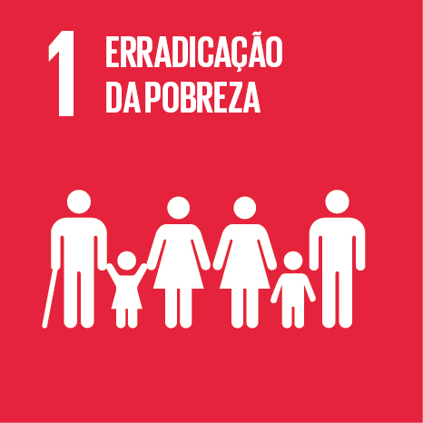</a></li>
  <li>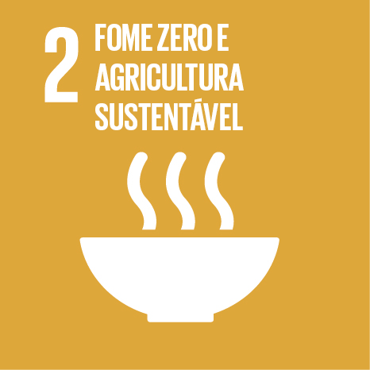</li>
  <li><a href="./ods3.html">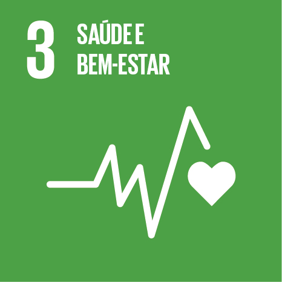</a></li>
  <li>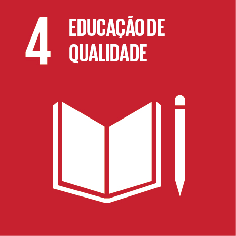</li>
  <li>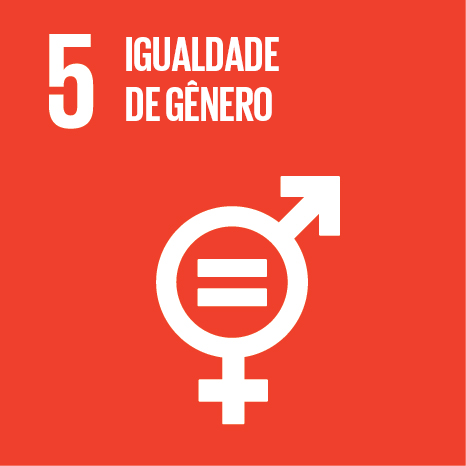</li>
  <li>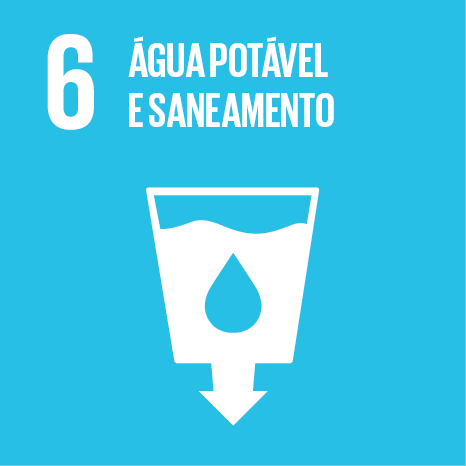</li>
  <li>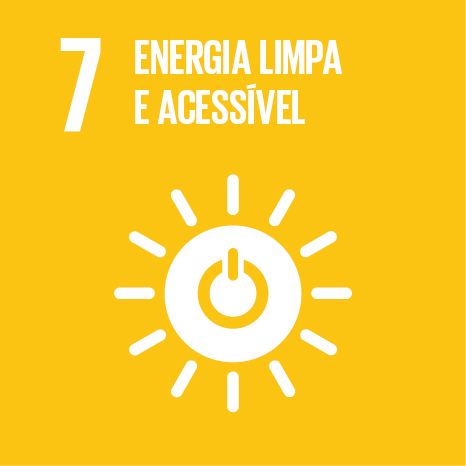</li>
  <li>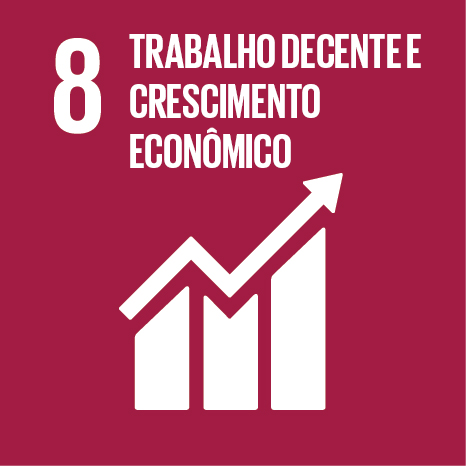</li>
  <li>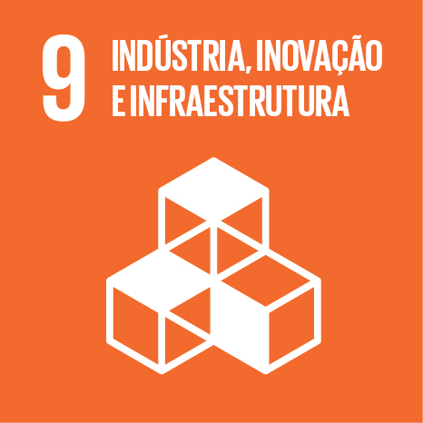</li>
  <li>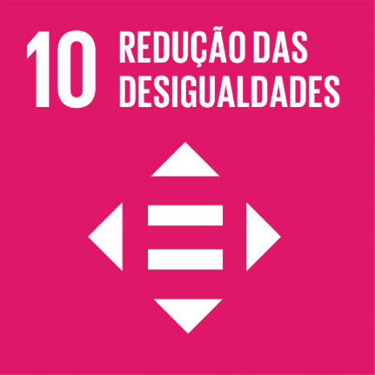</li>
  <li>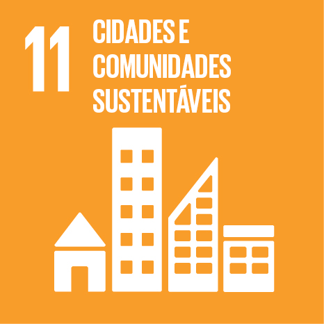</li>
  <li>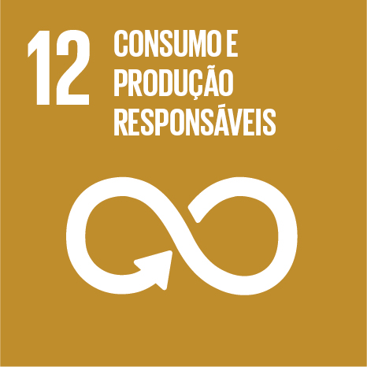</li>
  <li>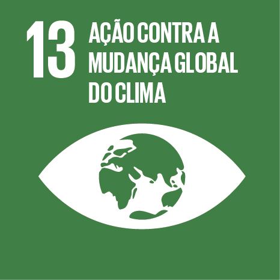</li>
  <li>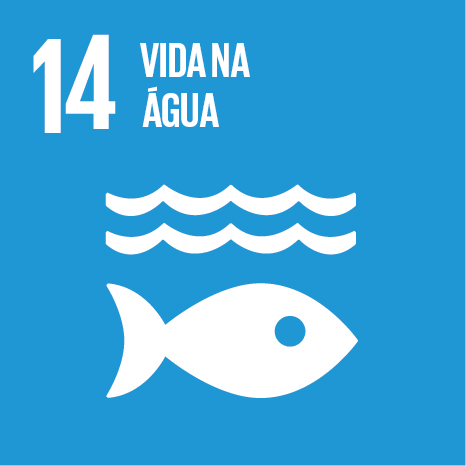</li>
  <li>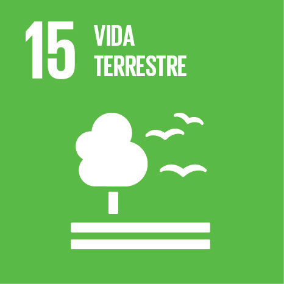</li>
  <li>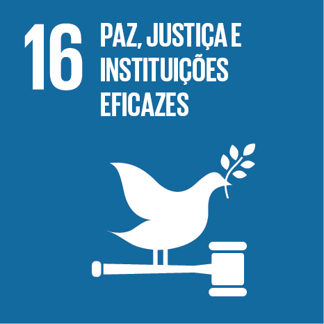</li>
  <li>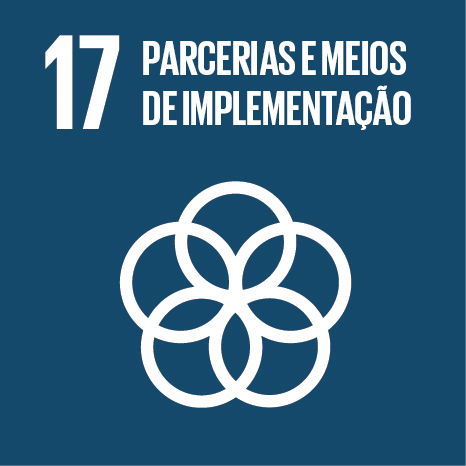</li>
  <li>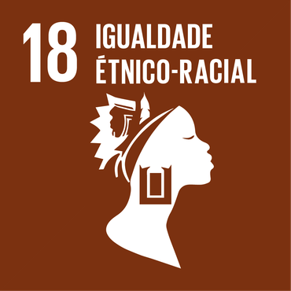</li>
</ul>
