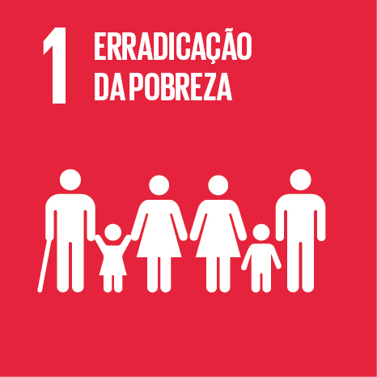

```js
import * as Plot from "@observablehq/plot";

const series = await FileAttachment("./data/series-ods1.json").json();
const percent = (valor) => valor == null ? "Sem dado" : new Intl.NumberFormat("pt-BR", {
  style: "percent", maximumFractionDigits: 1
}).format(valor / 100);
const etiquetas = {
  "5817": "Pobreza pela linha internacional",
  "5840": "Pobreza entre pessoas ocupadas de 14 anos ou mais",
  "5877": "Pobreza pela linha nacional"
};
const territorios = ["Minas Gerais", "Brasil"];
```

<section class="section-hero">
  
  <div><p class="eyebrow">INDICADORES <span> / </span> ODS 1</p><h1>Pobreza em Minas Gerais</h1>
  <p>Três séries do IBGE mostram a evolução de Minas Gerais e do Brasil pelos mesmos critérios.</p></div>
</section>

```js
for (const serie of series) {
  const anos = Array.from(new Set(serie.pontos.map((d) => d.ano))).sort((a, b) => a - b);
  const valores = new Map(serie.pontos.map((d) => [d.territorio + d.ano, d.valor]));
  const ultimo = anos.findLast((ano) => territorios.every((t) => valores.get(t + ano) != null));
  const legenda = html`<ul class="series-legend">
    ${territorios.map((t) => html`<li><span></span>${t} <strong>${percent(valores.get(t + ultimo))}</strong></li>`)}
    <li>${ultimo ?? "Sem ano comum"}</li>
  </ul>`;
  const grafico = resize((width) => Plot.plot({
    width, height: 275, marginLeft: 50,
    ariaLabel: serie.nome + " em Minas Gerais e no Brasil",
    x: {label: null, tickFormat: String, ticks: width < 560 ? 5 : anos},
    y: {label: "%", grid: true, zero: true},
    color: {domain: territorios, range: ["#c91f3c", "#536583"]},
    marks: [
      Plot.lineY(serie.pontos, {x: "ano", y: (d) => d.valor ?? NaN, stroke: "territorio", strokeWidth: 2.5}),
      Plot.dot(serie.pontos.filter((d) => d.valor != null), {x: "ano", y: "valor", fill: "territorio", r: 3, tip: true,
        title: (d) => d.territorio + " · " + d.ano + " · " + percent(d.valor)})
    ]
  }));
  display(html`<section class="panel series-panel">
    <p class="eyebrow">INDICADOR ${serie.indicador} · ${anos[0]}–${anos.at(-1)}</p>
    <h2>${etiquetas[serie.id]}</h2>
    <p class="muted">${serie.nome}</p>
    ${legenda}${grafico}
    <details><summary>Ver valores anuais</summary>
      <div class="table-scroll"><table>
        <thead><tr><th scope="col">Ano</th>${territorios.map((t) => html`<th scope="col">${t}</th>`)}</tr></thead>
        <tbody>${anos.map((ano) => html`<tr><th scope="row">${ano}</th>
          ${territorios.map((t) => html`<td>${percent(valores.get(t + ano))}</td>`)}
        </tr>`)}</tbody>
      </table></div>
    </details>
    <p class="muted">Fonte <a href="https://sidra.ibge.gov.br/tabela/${serie.id}">IBGE/SIDRA · tabela ${serie.id}</a></p>
  </section>`);
}
```

As séries cobrem o estado de Minas Gerais e o Brasil. Os pagamentos dos programas e os indicadores de pobreza têm fontes e períodos diferentes.
