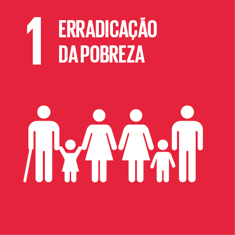

```js
import * as Inputs from "@observablehq/inputs";
import * as Plot from "@observablehq/plot";

const exercicios = await FileAttachment("./data/execucao-ods1.json").json();
const brl = new Intl.NumberFormat("pt-BR", {style: "currency", currency: "BRL"});
const compacto = new Intl.NumberFormat("pt-BR", {style: "currency", currency: "BRL", notation: "compact", maximumFractionDigits: 1});
const moeda = (valor) => valor == null ? "Sem registro" : brl.format(valor / 100);
const moedaCurta = (valor) => compacto.format(valor / 100);
const meses = ["jan", "fev", "mar", "abr", "mai", "jun", "jul", "ago", "set", "out", "nov", "dez"];
const etapas = [["pago", "Pago"], ["liquidado", "Liquidado"], ["empenhado", "Empenhado"]];
const normalizar = (texto) => texto.normalize("NFD").replace(/\p{M}/gu, "").toLowerCase();
const cor = "#c91f3c";
```

<section class="hero">
  <div><p class="eyebrow">MINAS GERAIS <span> / </span> AGENDA 2030</p>
  <h1>Erradicação<br>da pobreza</h1>
  <p>Execução orçamentária dos programas estaduais vinculados ao ODS 1.</p>
  <div class="hero-links"><a class="primary" href="#programas">Ver gastos por programa</a><a href="./indicadores">Indicadores de pobreza →</a></div></div>
  
</section>

```js
const seletor = Inputs.radio(exercicios, {
  label: "Exercício",
  value: exercicios.find((d) => !d.parcial) ?? exercicios[0],
  format: (d) => d.ano + (d.parcial ? " · parcial" : " · completo")
});
seletor.classList.add("periodos");
const exercicio = view(seletor);
```

```js
const programas = exercicio.programas.slice().sort((a, b) =>
  (b.pago ?? -Infinity) - (a.pago ?? -Infinity) || Number(a.codigo) - Number(b.codigo));
const comRegistro = programas.filter((d) => d.pago != null);
const total = Object.fromEntries(etapas.map(([campo]) => [
  campo, comRegistro.reduce((soma, d) => soma + d[campo], 0)
]));
const porMes = Array(exercicio.ultimoMes).fill(0);
for (const programa of comRegistro) {
  for (const {mes, pago} of programa.meses) porMes[mes - 1] += pago;
}
const pontos = porMes.map((pago, i) => ({mes: meses[i], pago}));
const maiores = comRegistro.filter((d) => d.pago > 0).slice(0, 6);
```

<div class="metrics" aria-live="polite">
  <section class="metric metric-main"><span>Valor pago no exercício</span><strong>${moeda(total.pago)}</strong><small>jan a ${meses[exercicio.ultimoMes - 1]} de ${exercicio.ano}${exercicio.parcial ? " · último mês parcial" : ""}</small></section>
  <section class="metric"><span>Valor liquidado</span><strong>${moeda(total.liquidado)}</strong><small>Despesas reconhecidas</small></section>
  <section class="metric"><span>Valor empenhado</span><strong>${moeda(total.empenhado)}</strong><small>Compromissos assumidos</small></section>
</div>
<p class="coverage"><strong>${programas.length} programas vinculados</strong> · ${comRegistro.length} com registros no SIAFI-MG. O total soma os pagamentos do exercício, sem os restos a pagar de anos anteriores.</p>

<div class="overview">
  <section class="panel">
    <p class="eyebrow">EXECUÇÃO</p><h2>Pagamentos por mês</h2>
    ${resize((width) => Plot.plot({
      width, height: 270, marginLeft: 83,
      ariaLabel: "Valor pago por mês",
      x: {domain: pontos.map((d) => d.mes), label: null},
      y: {label: null, grid: true, tickFormat: moedaCurta},
      marks: [Plot.ruleY([0]), Plot.barY(pontos, {x: "mes", y: "pago", fill: cor, tip: true, title: (d) => moeda(d.pago)})]
    }))}
  </section>
  <section class="panel">
    <p class="eyebrow">RANKING</p><h2>Maiores pagamentos</h2>
    ${html`<ol class="ranking">${maiores.map((d) => html`<li>
      <span class="program-name"><small>${d.codigo}</small> ${d.nome}</span><strong>${moedaCurta(d.pago)}</strong>
      <div class="rank-track"><span style=${{width: (100 * d.pago / maiores[0].pago) + "%"}}></span></div>
    </li>`)}</ol>`}
  </section>
</div>

## Programas

Consulte todos os programas vinculados. A previsão é anual, enquanto a execução reflete o período disponível.

```js
const busca = view(Inputs.text({label: "Buscar programa", placeholder: "Digite um código ou nome"}));
```

```js
const consulta = normalizar(busca.trim());
const filtrados = programas.filter((d) => normalizar(d.codigo + " " + d.nome).includes(consulta));
display(filtrados.length ? html`<div class="table-scroll" role="region" aria-label="Execução por programa" tabindex="0">
  <table class="program-table">
    <thead><tr><th scope="col">Código e programa</th><th scope="col">Pago</th><th scope="col">Liquidado</th><th scope="col">Empenhado</th><th scope="col">Previsão PPAG</th></tr></thead>
    <tbody>${filtrados.map((d) => html`<tr>
      <th scope="row"><span class="program-code">${d.codigo}</span> ${d.nome}<small>${d.unidade}</small></th>
      <td><strong>${moeda(d.pago)}</strong></td><td>${moeda(d.liquidado)}</td><td>${moeda(d.empenhado)}</td><td>${moeda(d.previsto)}</td>
    </tr>`)}</tbody>
  </table>
</div>` : html`<p class="panel">Nenhum programa encontrado para esta busca.</p>`);
```

## Fontes e critérios

```js
display(html`<p>Execução orçamentária: <a href=${exercicio.fonte}>SIAFI-MG, exercício ${exercicio.ano}</a>. Vínculos temáticos e previsão: ${exercicio.vinculos}, base de referência fornecida para o projeto.</p>`);
```

Valores nominais por código de programa e exercício. O pago corresponde ao campo **Valor Pago Orçamentário**. Cada programa entra uma vez no total, com seu valor integral. A associação ao ODS 1 é temática e pode coexistir com vínculos a outros ODS. O total não estima quanto foi aplicado exclusivamente para reduzir a pobreza.
