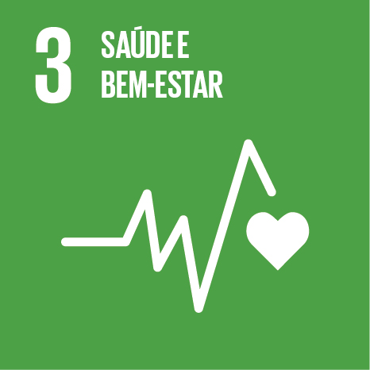

```js
import {painelSerie} from "./series.js";

const series = await FileAttachment("./data/series-ods3.json").json();
const etiquetas = {
  "6694": "Mortalidade materna",
  "6695": "Mortalidade em menores de 5 anos",
  "6696": "Mortalidade neonatal",
  "8415": "Incidência de hepatite B"
};
```

<section class="section-hero ods3-theme">
  
  <div><p class="eyebrow">INDICADORES <span> / </span> ODS 3</p><h1>Saúde e bem-estar em Minas Gerais</h1>
  <p>Compare Minas Gerais e Brasil em quatro indicadores oficiais. Os períodos e as unidades variam por série.</p></div>
</section>

```js
for (const serie of series) {
  display(painelSerie(serie, etiquetas[serie.id], "#377e37", resize));
}
```
